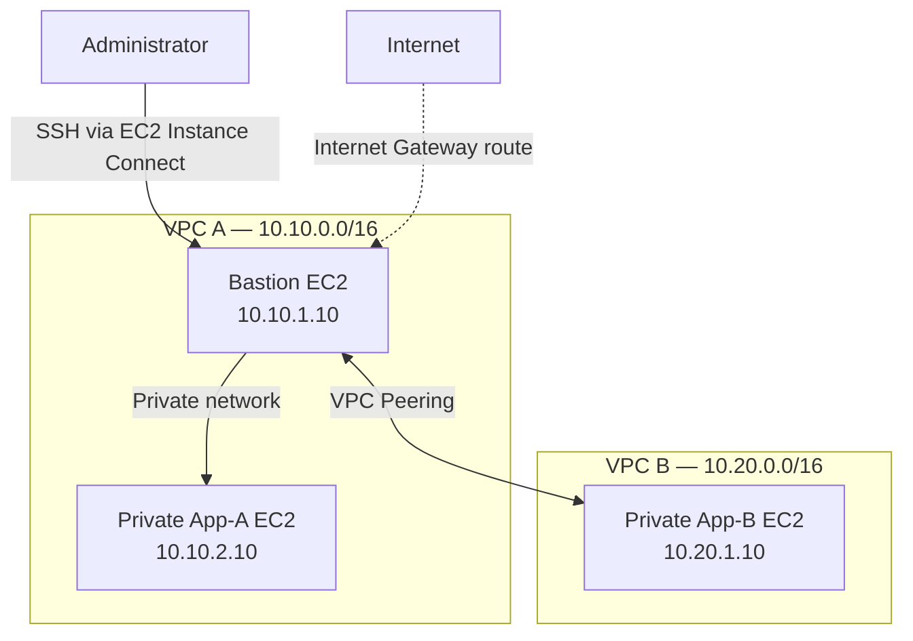

# AWS VPC Peering with Secure Private-Instance Communication

## Project Overview

This project demonstrates how to connect two isolated Amazon Virtual Private Clouds (VPCs) using AWS VPC Peering. It uses private EC2 instances, custom route tables, and security groups to demonstrate communication between workloads across VPC boundaries.

**Project status:** Core network connectivity tested successfully.

## Objectives

- Create two VPCs with non-overlapping CIDR ranges.
- Configure public and private subnets.
- Establish a VPC peering connection.
- Configure routes for private communication between VPCs.
- Use a bastion host to access and test private workloads.
- Validate connectivity using ICMP and TCP port checks.
- Apply security group rules that restrict access to specified sources.

## Architecture



The diagram represents the intended network design. The successful connectivity tests below confirm the tested paths.

## AWS Resources

| Resource | Configuration |
|---|---|
| AWS Region | Asia Pacific (Sydney), `ap-southeast-2` |
| VPC A | `10.10.0.0/16` |
| VPC B | `10.20.0.0/16` |
| Public subnet A | `10.10.1.0/24` |
| Private subnet A | `10.10.2.0/24` |
| Private subnet B | `10.20.1.0/24` |
| Bastion host | `10.10.1.10` |
| Private instance App-A | `10.10.2.10` |
| Private instance App-B | `10.20.1.10` |
| Peering connection | `pcx-021693724af9dada1` |
| EC2 operating system | Amazon Linux 2023 |
| EC2 instance type | `t3.micro` |

## Routing Design

The VPCs use non-overlapping address ranges.

- VPC A has a route to `10.20.0.0/16` through the VPC peering connection.
- VPC B has a route to `10.10.0.0/16` through the VPC peering connection.
- The public subnet in VPC A has a default route through its Internet Gateway.
- Private instances do not require public IP addresses to communicate over the peering connection.

VPC peering is not transitive. Communication between the two VPCs depends on appropriate routes and security rules at both ends.

## Security Design

- The bastion host is the intended administrative entry point.
- SSH access to the bastion is restricted by security group rules rather than being open to every IPv4 address.
- App-A and App-B have no public IP addresses.
- Security groups allow only the configured traffic sources and protocols.
- AWS credentials and private SSH keys must never be committed to the repository.

EC2 Instance Connect was used to access the bastion for testing. This project does not claim that SSH authentication from the local Windows computer was resolved.

## Connectivity Test Results

Tests were executed from the bastion host.

| Source | Destination | Test | Result |
|---|---|---|---|
| Bastion (`10.10.1.10`) | App-A (`10.10.2.10`) | ICMP ping, 4 packets | PASS — 0% packet loss |
| Bastion (`10.10.1.10`) | App-B (`10.20.1.10`) | ICMP ping, 4 packets | PASS — 0% packet loss |
| Bastion | App-A TCP/22 | Bash TCP connection check | PASS — reachable |
| Bastion | App-B TCP/22 | Bash TCP connection check | PASS — reachable across peering |

These results establish reachability from the bastion to both private instances, including across the VPC peering connection. They do not independently verify application-layer functionality or successful SSH authentication to the private instances.

## Deployment and Verification

The AWS resources were configured in the AWS Management Console and verified with the AWS CLI. The following commands can be used to inspect the configuration after configuring AWS CLI credentials and selecting the correct profile.

Check the peering connection:

```bash
aws ec2 describe-vpc-peering-connections \
  --region ap-southeast-2 \
  --profile intern-aws
```

Inspect route tables:

```bash
aws ec2 describe-route-tables \
  --region ap-southeast-2 \
  --profile intern-aws
```

Check instance state:

```bash
aws ec2 describe-instances \
  --region ap-southeast-2 \
  --profile intern-aws
```

Do not publish AWS credentials or private keys. The `intern-aws` profile name is specific to the original development environment; configure your own profile if reproducing this lab.

## Cost Management

The three EC2 instances were stopped after the connectivity tests.

Stopping EC2 instances does not necessarily eliminate all AWS charges. EBS volumes, public IPv4 addresses, and other retained resources may still incur costs. Review the account's active resources and billing dashboard before leaving the lab idle.

## Evidence

Add your genuine, unaltered screenshots to the `screenshots/` directory, such as:

- `vpc-peering-status.png`
- `route-table-configuration.png`
- `vpc-peering-connectivity-test.png`

Only include screenshots after saving them. Do not add placeholder images or claim evidence exists when it has not been captured.

## Skills Demonstrated

- Amazon VPC and subnet design
- VPC peering and route table configuration
- EC2 administration
- Security group configuration
- Private network troubleshooting
- AWS CLI and Windows PowerShell
- Connectivity testing and technical documentation
- Basic cloud cost awareness

## Future Improvements

- Automate resource provisioning using Terraform or AWS CloudFormation.
- Add repeatable deployment and cleanup scripts.
- Test application-level communication between the private instances.
- Expand monitoring and logging.
- Add a documented cleanup checklist for all retained AWS resources.

## Author

Sunil M

Cloud Networking Project
