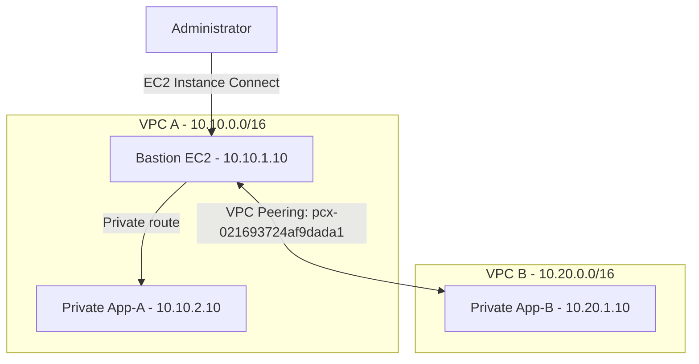

# AWS VPC Peering Architecture

## Network Layout

## Network Configuration

| Component | Value |
|---|---|
| AWS Region | `ap-southeast-2` |
| VPC A CIDR | `10.10.0.0/16` |
| VPC B CIDR | `10.20.0.0/16` |
| VPC A public subnet | `10.10.1.0/24` |
| VPC A private subnet | `10.10.2.0/24` |
| VPC B private subnet | `10.20.1.0/24` |
| Peering connection | `pcx-021693724af9dada1` |

## Traffic Flow

1. The administrator accesses the bastion through EC2 Instance Connect.
2. The bastion reaches App-A through VPC A's local routing.
3. The bastion reaches App-B using VPC A's route to `10.20.0.0/16`, the peering connection, and VPC B's return route to `10.10.0.0/16`.
4. Security groups control which protocols and source ranges are permitted.

## Validation

The recorded tests from the bastion succeeded for ICMP ping and TCP port 22 reachability to both private instances. See [Testing Report](testing.md) for the detailed results.
